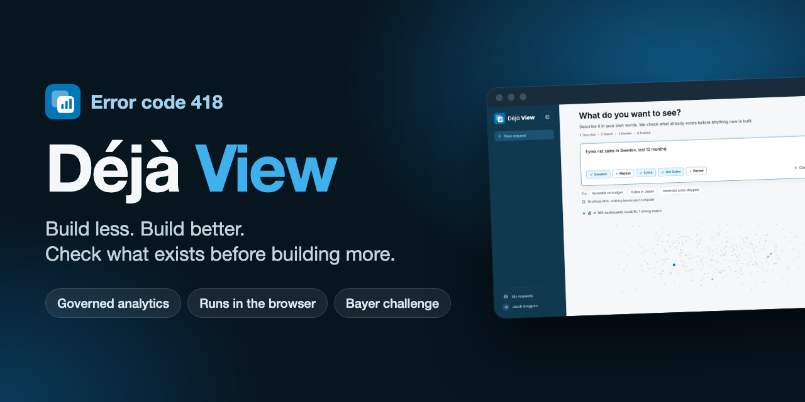
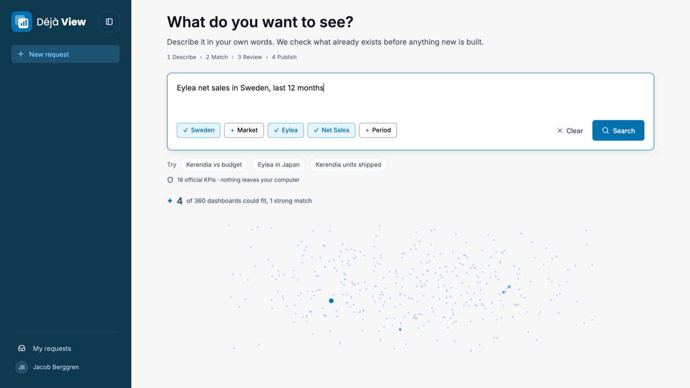
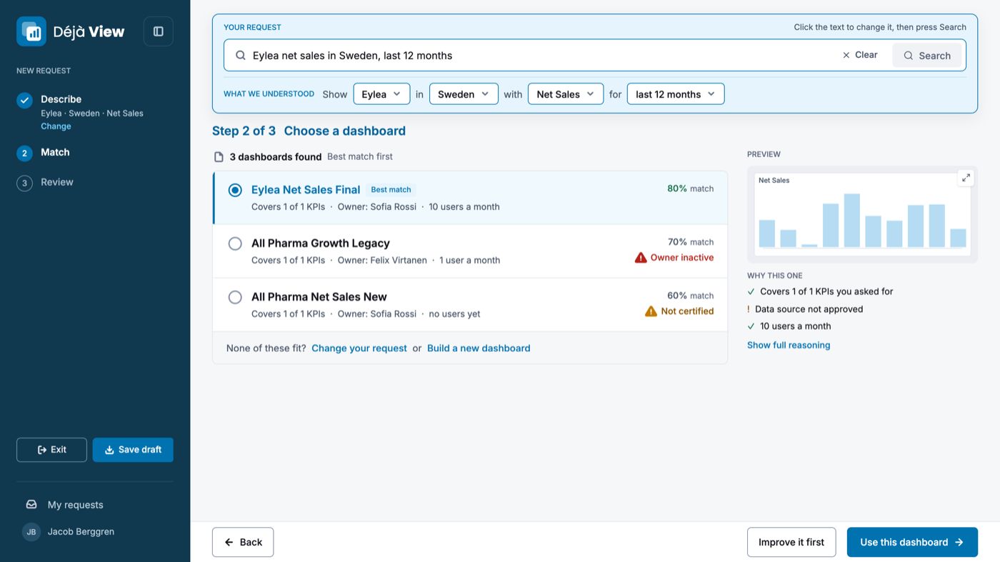
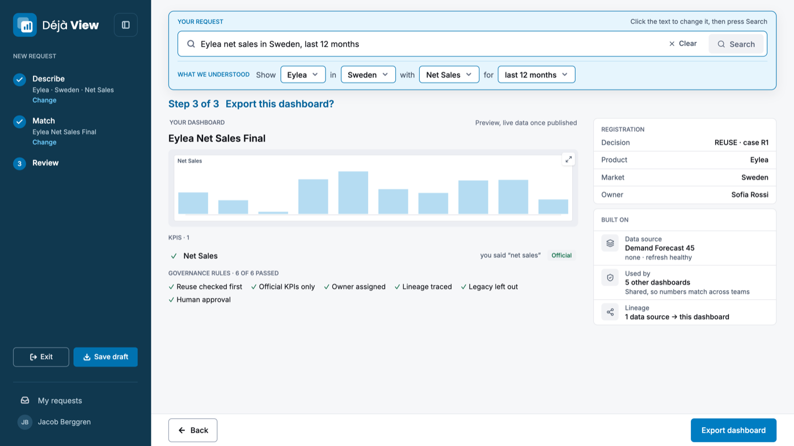
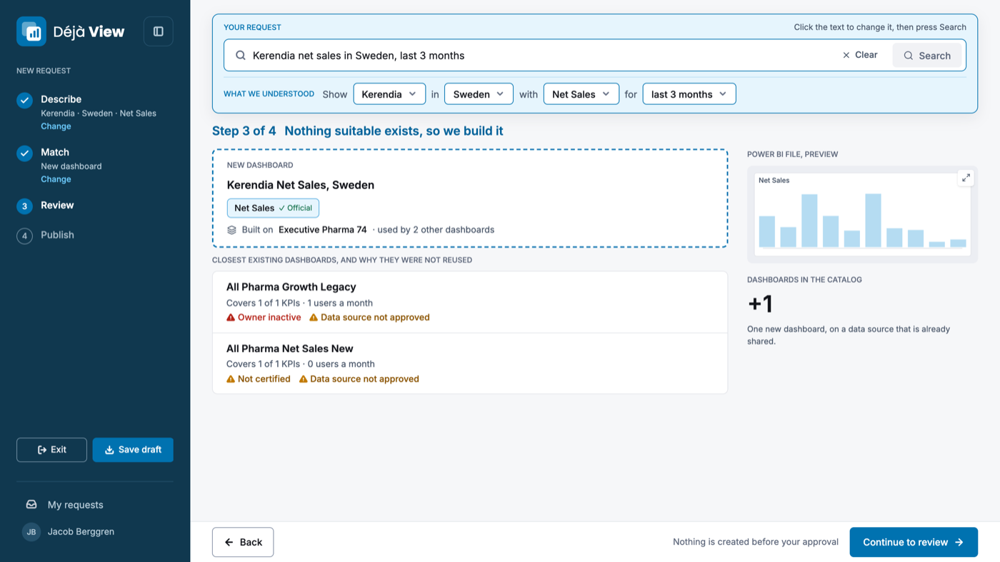

  

  
  
  
  
  

  Team <b>Error code 418</b> · Since AI Hackathon, Turku, 6-8 Nov 2026 
  Challenge: <b>Bayer, "Build Less, Build Better: AI for Governed Analytics"</b>

> [!CAUTION]
> **Copyright © 2026 Team Error code 418. All rights reserved. This is NOT open source.**
>
> You may look at this page. You may **not** copy, reuse, modify, redistribute, host, sell, train on, or build anything derived from this project or any part of it without prior written permission from the authors. See [LICENSE](LICENSE).

## Demo video

https://github.com/user-attachments/assets/f5d89151-ec7a-4434-8476-7313f1c1dafc

This repository only presents the project. The source code is private (see [Why is the code private?](#why-is-the-code-private)).

## The problem

Self-service BI creates dashboard sprawl: duplicated KPI logic, unclear owners, technical debt. AI agents make it worse, because building one more dashboard becomes effortless. Bayer's own words: *"The next breakthrough may not be building more analytics. It may be knowing what deserves to exist at all."*

## What it does

Type a request such as *"Show Kerendia in Sweden against budget per month"*. Déjà View:

1. **Understands** it, and shows what it understood so the user can correct it.
2. **Searches** the catalog of existing reports, judging them on what they actually contain rather than what they are called.
3. **Decides** one of four outcomes:

| Outcome | Meaning |
|---|---|
| **REUSE** | A trusted report already answers it. Open it. |
| **EXTEND** | A new report replaces an untrusted one, on the same approved data source. |
| **CREATE** | Nothing fits, but an approved data source has what is needed: build a thin report on it. |
| **No build** | No approved data source fits: send a request to the BI team. |

4. **Explains** the decision in plain language: what to do, why, and what changes.
5. **Exports** a Power BI project and registers it, so the next person who asks finds it.

Nothing is created without an explicit click.

<table>
  <tr>
    <td width="50%"></td>
    <td width="50%"></td>
  </tr>
  <tr>
    <td align="center"><b>1. Describe</b> Plain English, with editable chips showing what was understood</td>
    <td align="center"><b>2. Match</b> Existing dashboards ranked, with the trust warnings visible</td>
  </tr>
  <tr>
    <td width="50%"></td>
    <td width="50%"></td>
  </tr>
  <tr>
    <td align="center"><b>3. Review</b> The decision, governance rules, owner and lineage</td>
    <td align="center"><b>Or build</b> Only when nothing fits</td>
  </tr>
</table>

## How it works, in short

Code drives the flow and AI assists. A small AI model runs locally in the browser and is used only where text must be understood or written. The decisions themselves are made by transparent rules, so every outcome can be traced and explained. Everything runs in the browser: there is no backend, and no BI metadata leaves the user's machine.

## Governance

- Trust is judged on several signals together, not on certification alone.
- Official KPI definitions come first, and the user is told when a local variant is replaced.
- Every new report has an owner and a visible data source.
- Every decision is explained and logged.
- The human always decides.

## Data

Built on Bayer's **synthetic** data pack. Nothing here is real Bayer performance.

## Limitations

- A prototype: no authentication and no real publishing to Power BI.
- Synthetic data: names, owners and figures are illustrative.
- The local AI model needs a browser with WebGPU.

## Why is the code private?

Déjà View was built in 38 hours by four people at the Since AI Hackathon, and the source code is the team's work. We keep it in a private repository so that nobody can copy it and use it as their own. This public page shows what we built, how it looks and how it behaves, without giving the implementation away.

Want to know more, or to discuss access or licensing? Reach out to the team through the GitHub profile of [@Jacobberggreen](https://github.com/Jacobberggreen).

## Team

**Jacob Berggren, Omar Lundgren, Sebastian Gabrielsson, Adam Hultgren**. Built with the help of Claude Code.

## License

**Copyright © 2026 Team Error code 418. All rights reserved.** Proprietary, not open source. No permission is granted to use, copy, modify, distribute, host, sell or create derivative works from any part of this project without prior written permission. See [LICENSE](LICENSE).
